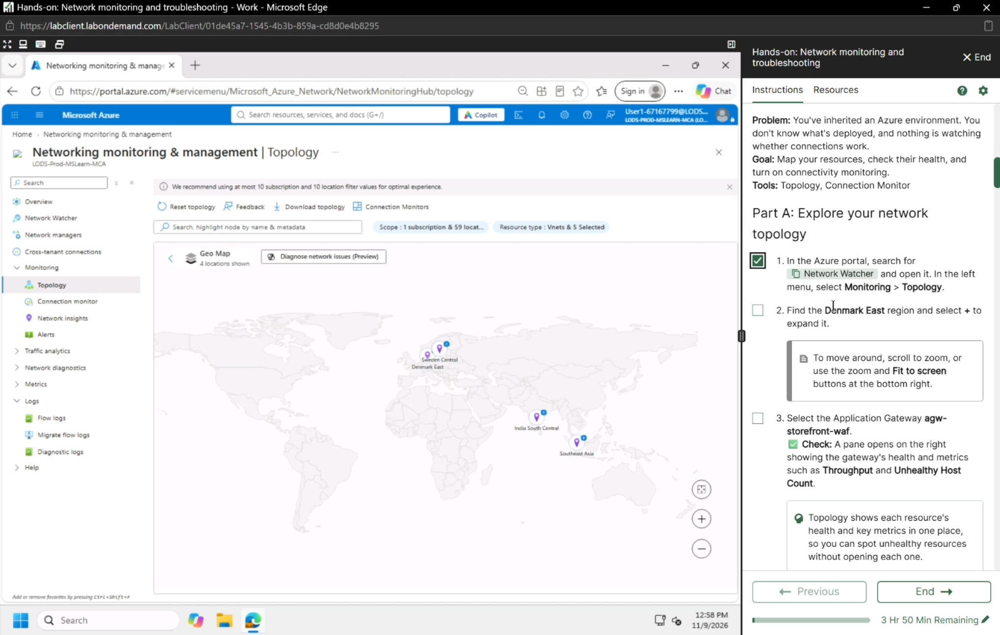
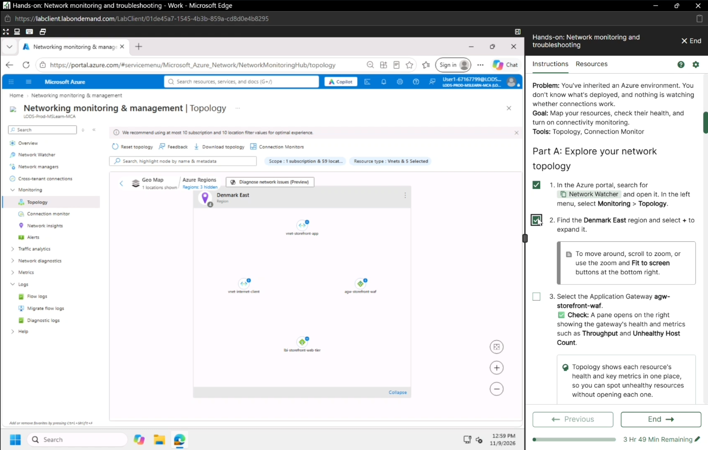
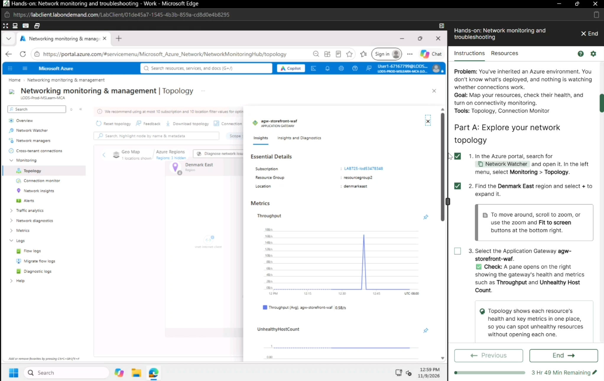
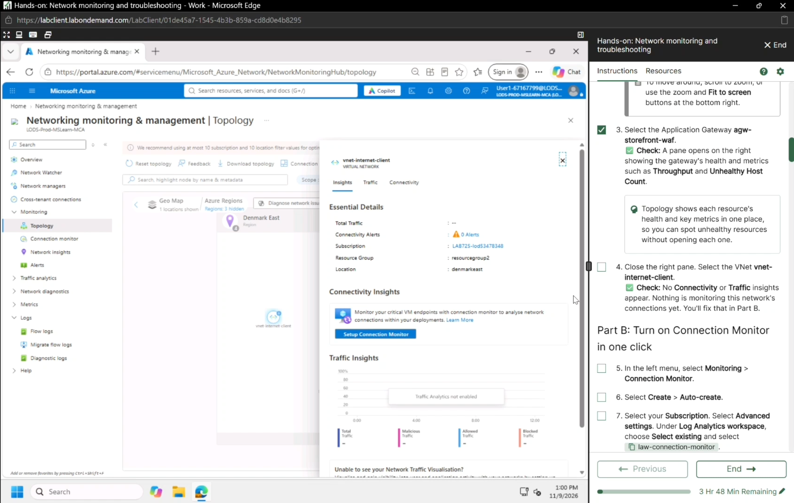
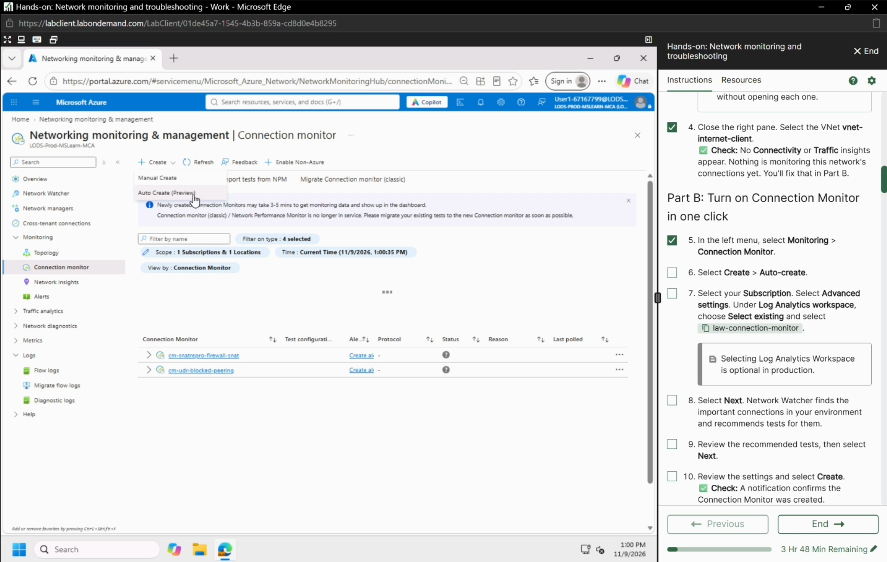
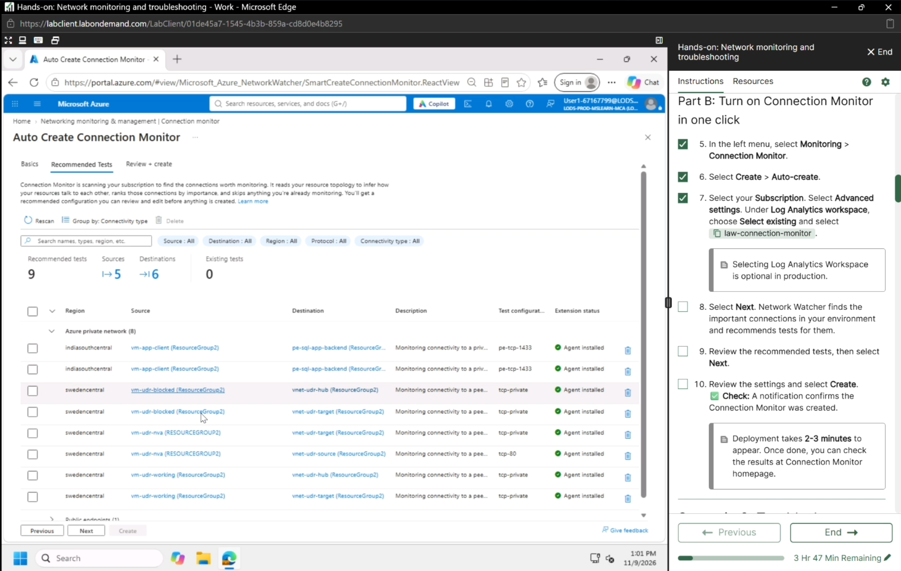

# 01 - Network Visualization and Enable Monitoring

⬅️ [00 - Introduction](./00-Introduction.md) | **Next:** [02 - Monitor and Troubleshoot Connectivity Issues](./02-Monitor-and-Troubleshoot-Connectivity-Issues.md) ➡️

---

**Part 1: Connectivity monitoring and troubleshooting**

| | |
|---|---|
| **Problem** | You've inherited an Azure environment. You don't know what's deployed, and nothing is watching whether connections work. |
| **Goal** | Map your resources, check their health and turn on connectivity monitoring. |
| **Tools** | Topology, Connection Monitor |
| **Time** | 5-10 minutes |

---

## 🎬 Demo video

<!-- TODO: Replace the link below with the demo video URL -->
[Watch the Module 01 demo](VIDEO_LINK_01_NETWORK_VISUALIZATION)

---

## Part A: Explore your network topology

1. In the Azure portal, search for **Network Watcher** and open it. In the left menu, select **Monitoring** > **Topology**.

   

2. Find the **Denmark East** region and select **+** to expand it. You can also hover over **Denmark East** and select **Expand** on the hover card.

   

> [!NOTE]
> To move around, scroll to zoom, or use the zoom and **Fit to screen** buttons at the bottom right.

3. Select the Application Gateway **agw-storefront-waf**.

   ✅ **Check:** A pane opens on the right showing the gateway's health and metrics such as **Throughput** and **Unhealthy Host Count**.

   

> [!NOTE]
> **Key concept:** Topology shows each resource's health and key metrics in one place, so you can spot unhealthy resources without opening each one.

4. Close the right pane. Select the VNet **vnet-internet-client**.

   ✅ **Check:** No **Connectivity** or **Traffic** insights appear. Nothing is monitoring this network's connections yet. You'll fix that in Part B.

   

---

## Part B: Turn on Connection Monitor in one click

5. In the left menu of **Network Watcher**, select **Monitoring** > **Connection Monitor**.

6. Select **Create** > **Auto-create**.

   

7. Select your **Subscription**. Select **Advanced settings**. Under **Log Analytics workspace**, choose **Select existing** and select **law-connection-monitor**.

> [!NOTE]
> Selecting a Log Analytics workspace is optional in production.

8. Select **Next**. Network Watcher finds the important connections in your environment and recommends tests for them.

9. Review the recommended tests, then select **Next**.

   

10. Review the settings and select **Create**.

    ✅ **Check:** A notification confirms the Connection Monitor was created.

> [!NOTE]
> Deployment takes **2-3 minutes** to appear. When it's done, you can check the results on the Connection Monitor home page.

> [!TIP]
> **Troubleshooting:** If your deployment fails, check with the speaker or proctor. It may be an issue with the resource deployment. It won't affect the rest of the lab.

---

## What you learned

| Tool | What you did |
|---|---|
| Topology | Mapped your resources across regions and checked their health and key metrics in one view |
| Connection Monitor | Turned on connectivity monitoring in one click, with tests recommended for your environment |

---

⬅️ [00 - Introduction](./00-Introduction.md) | **Next:** [02 - Monitor and Troubleshoot Connectivity Issues](./02-Monitor-and-Troubleshoot-Connectivity-Issues.md) ➡️
