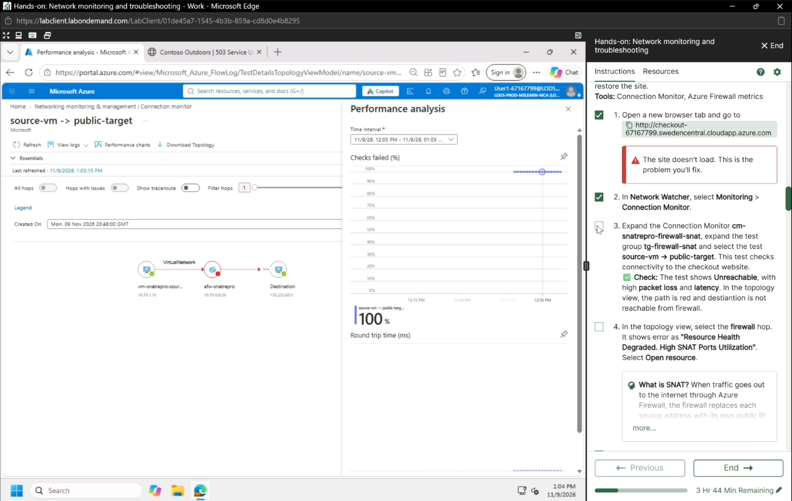
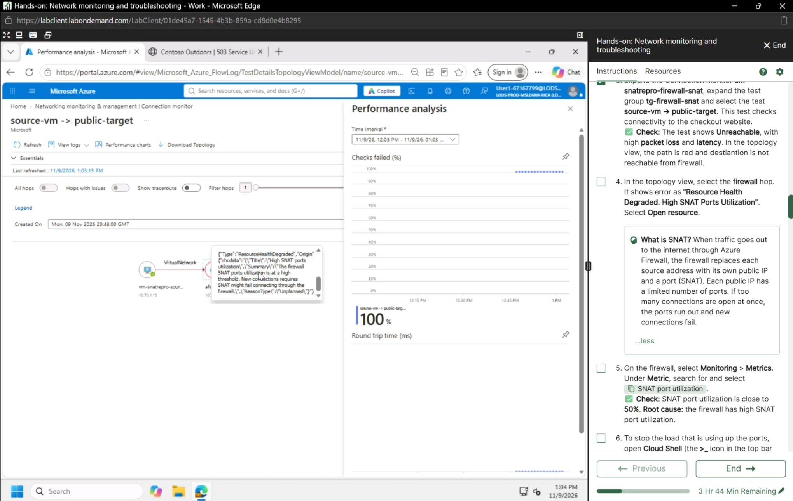
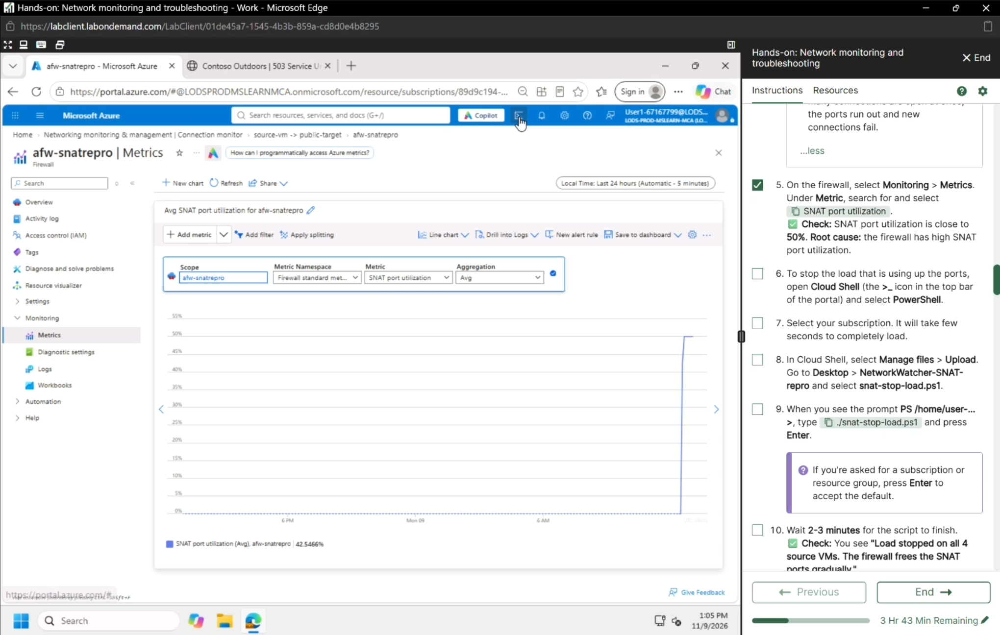
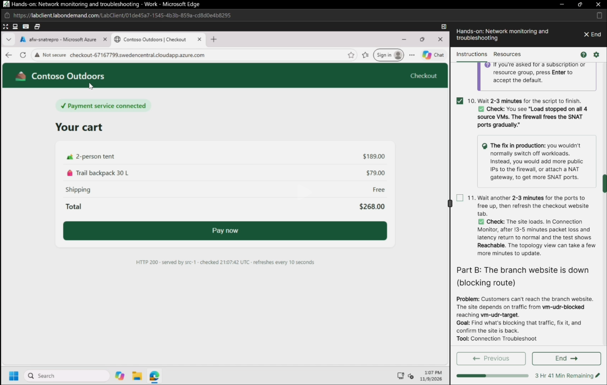
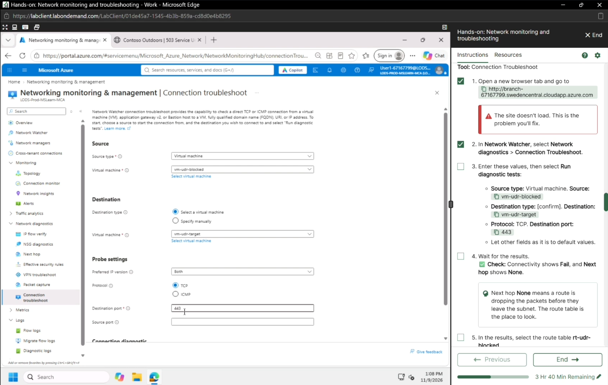
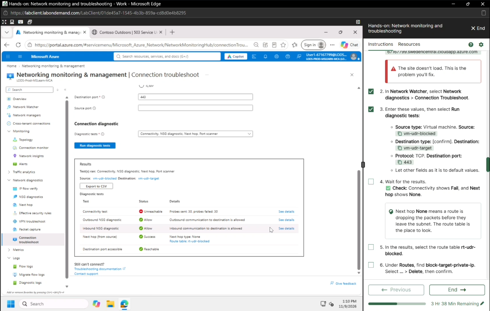
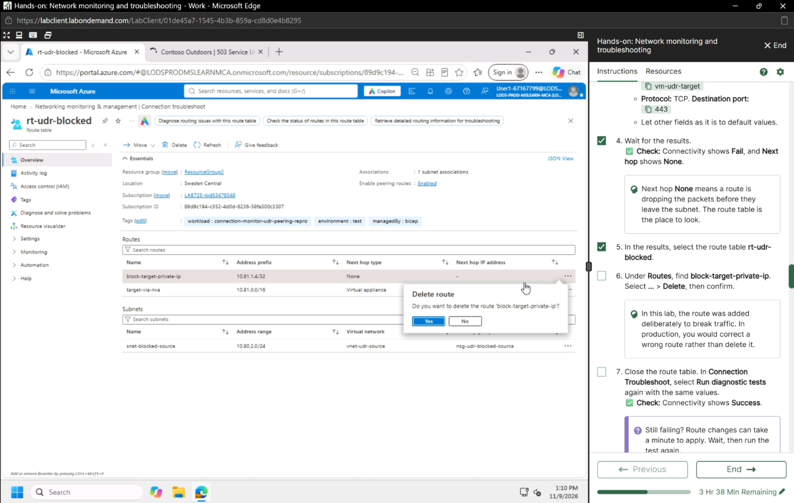
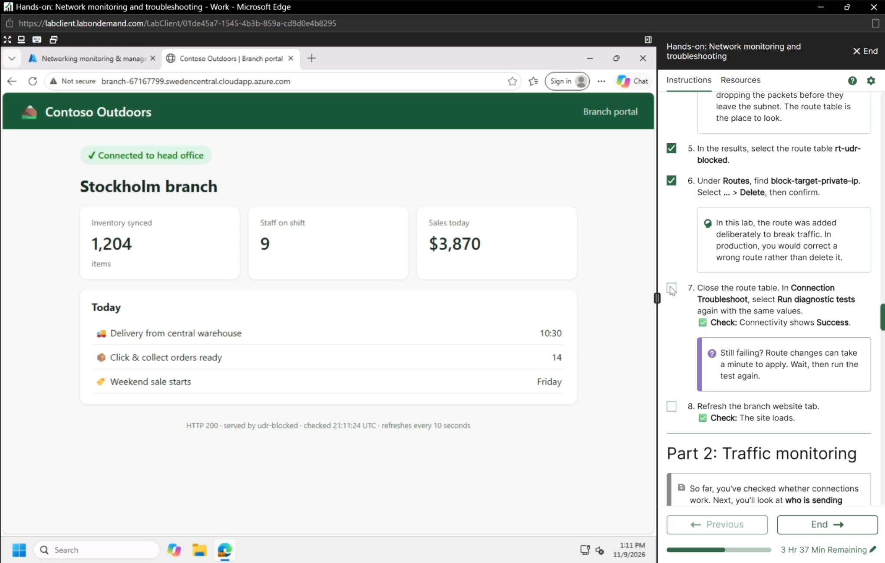

# 02 - Monitor and Troubleshoot Connectivity Issues

⬅️ [01 - Network Visualization and Enable Monitoring](./01-Network-Visualization-and-Enable-Monitoring.md) | **Next:** [03 - Intro to Flow Logs and PLS Support](./03-Intro-to-Flow-Logs-and-PLS-Support.md) ➡️

---

**Part 1: Connectivity monitoring and troubleshooting**

In this module, you'll troubleshoot two outages and find the root cause of each:

- [Part A: The checkout website is down (SNAT port exhaustion)](#part-a-the-checkout-website-is-down-snat-port-exhaustion)
- [Part B: The branch website is down (blocking route)](#part-b-the-branch-website-is-down-blocking-route)

---

## 🎬 Demo video

<!-- TODO: Replace the link below with the demo video URL -->
[Watch the Module 02 demo](VIDEO_LINK_02_TROUBLESHOOT_CONNECTIVITY)

---

## Part A: The checkout website is down (SNAT port exhaustion)

| | |
|---|---|
| **Problem** | Customers can't reach the checkout website. |
| **Goal** | Find where the traffic fails, identify why and restore the site. |
| **Tools** | Connection Monitor, Azure Firewall metrics |
| **Time** | 5-10 minutes |

1. Open a new browser tab and go to `http://checkout-<lab-instance-id>.swedencentral.cloudapp.azure.com`.

> [!WARNING]
> The site doesn't load. This is the problem you'll fix.

2. In the Azure portal, search for **Network Watcher** and select **Monitoring** > **Connection Monitor**.

3. Expand the Connection Monitor **cm-snatrepro-firewall-snat**, expand the test group **tg-firewall-snat** and select the test **source-vm -> public-target**. This test checks connectivity to the checkout website.

   ✅ **Check:** The test shows **Unreachable**, with a high **Checks failed (%)**. In the topology view, the path is red.

   

4. In the topology view, select the firewall hop **afw-snatrepro**. It shows the error **"Resource Health Degraded. High SNAT Ports Utilization"**. Select **Open resource**.

   

> [!NOTE]
> **Key concept: What is SNAT?** When traffic goes out to the internet through Azure Firewall, the firewall replaces each source address with its own public IP and a port (source network address translation, or SNAT). Each public IP has a limited number of ports. If too many connections are open at once, the ports run out and new connections fail.

5. On the firewall, select **Monitoring** > **Metrics**. Under **Metric**, search for and select **SNAT port utilization**.

   ✅ **Check:** Average SNAT port utilization is close to **50%**. **Root cause:** the firewall has high SNAT port utilization.

   

> [!NOTE]
> **Key concept:** The Connection Monitor test uses **TCP**. The average SNAT port utilization of 50% is across both **TCP (100%)** and **UDP (0%)**. You can add a protocol filter to look at each one separately.

6. To stop the load that's using up the ports, open **Cloud Shell** (the **>_** icon in the top bar of the portal) and select **PowerShell**.

7. Select your subscription. It takes a few seconds to load.

8. In Cloud Shell, select **Manage files** > **Upload**. Go to **Desktop** > **NetworkWatcher-SNAT-repro** and select **snat-stop-load.ps1**.

   <!-- TODO: If the script is published in this repo, link it here, for example: [snat-stop-load.ps1](../scripts/snat-stop-load.ps1) -->

9. When you see the prompt **PS /home/user-...>**, type `./snat-stop-load.ps1` and press **Enter**.

> [!TIP]
> **Troubleshooting:** If you're asked for a subscription or resource group, press **Enter** to accept the default.

10. Wait **2-3 minutes** for the script to finish.

    ✅ **Check:** You see **"Load stopped on all 4 source VMs. The firewall frees the SNAT ports gradually."**

> [!IMPORTANT]
> **Production tip:** You wouldn't normally switch off workloads to fix this. Instead, you'd add more public IPs to the firewall, or attach a NAT gateway, to get more SNAT ports.

11. Refresh the checkout website tab. The checkout service is now reachable.

    ✅ **Check:** The site loads. In Connection Monitor, after about 3-5 minutes, packet loss and latency return to normal and the test shows **Reachable**. The topology view can take a few more minutes to update.

    

---

## Part B: The branch website is down (blocking route)

| | |
|---|---|
| **Problem** | Customers can't reach the branch website. The site depends on traffic from **vm-udr-blocked** reaching **vm-udr-target**. |
| **Goal** | Find what's blocking that traffic, fix it and confirm the site is back. |
| **Tool** | Connection Troubleshoot |
| **Time** | 5 minutes |

1. Open a new browser tab and go to `http://branch-<lab-instance-id>.swedencentral.cloudapp.azure.com`.

> [!WARNING]
> The site doesn't load. This is the problem you'll fix.

2. In the Azure portal, go to **Network Watcher** and select **Network diagnostics** > **Connection Troubleshoot**.

3. Enter these values, then select **Run diagnostic tests**:

   | Field | Value |
   |---|---|
   | **Source type** | Virtual machine |
   | **Source** | `vm-udr-blocked` |
   | **Destination type** | Virtual machine |
   | **Destination** | `vm-udr-target` |
   | **Protocol** | TCP |
   | **Destination port** | `443` |

   Leave the other fields at their default values.

   

4. Wait for the results. This takes 2-3 minutes.

   ✅ **Check:** Connectivity shows **Fail**, and **Next hop** shows **None**.

   

> [!NOTE]
> **Key concept:** A next hop of **None** means a route is dropping the packets before they leave the subnet. The route table is the place to look.

5. In the results, select the route table **rt-udr-blocked**.

6. Under **Routes**, find **block-target-private-ip**. Select **...** > **Delete**, then confirm.

   

> [!IMPORTANT]
> **Production tip:** In this lab, the route was added on purpose to break traffic. In production, you'd correct a wrong route rather than delete it.

7. Close the route table. In **Connection Troubleshoot**, select **Run diagnostic tests** again with the same values. While it runs, refresh the branch website tab. The service is up and running.

   ✅ **Check:** The site loads. Connection Troubleshoot shows connectivity as **Success**.

   

> [!TIP]
> **Troubleshooting:** Still failing? Route changes can take a minute to apply. Wait, then run the test again.

---

## What you learned

| Part | Tool | What you did |
|---|---|---|
| A | Connection Monitor, Azure Firewall metrics | Found SNAT port exhaustion on the firewall and learned how to fix it in production |
| B | Connection Troubleshoot | Found and fixed a route that blocked traffic between two VMs |

---

⬅️ [01 - Network Visualization and Enable Monitoring](./01-Network-Visualization-and-Enable-Monitoring.md) | **Next:** [03 - Intro to Flow Logs and PLS Support](./03-Intro-to-Flow-Logs-and-PLS-Support.md) ➡️
