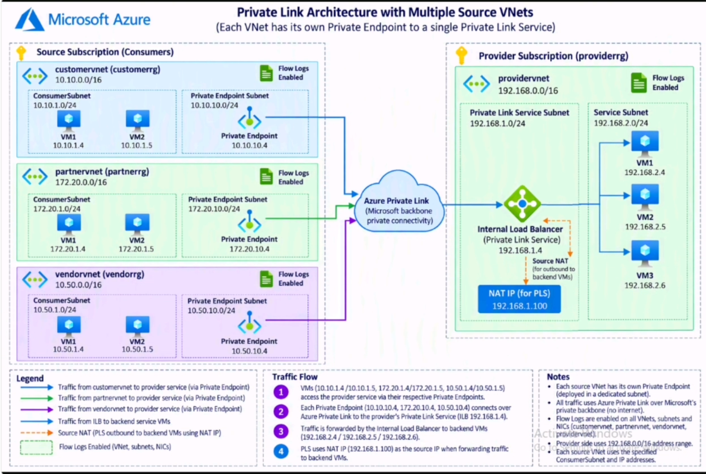
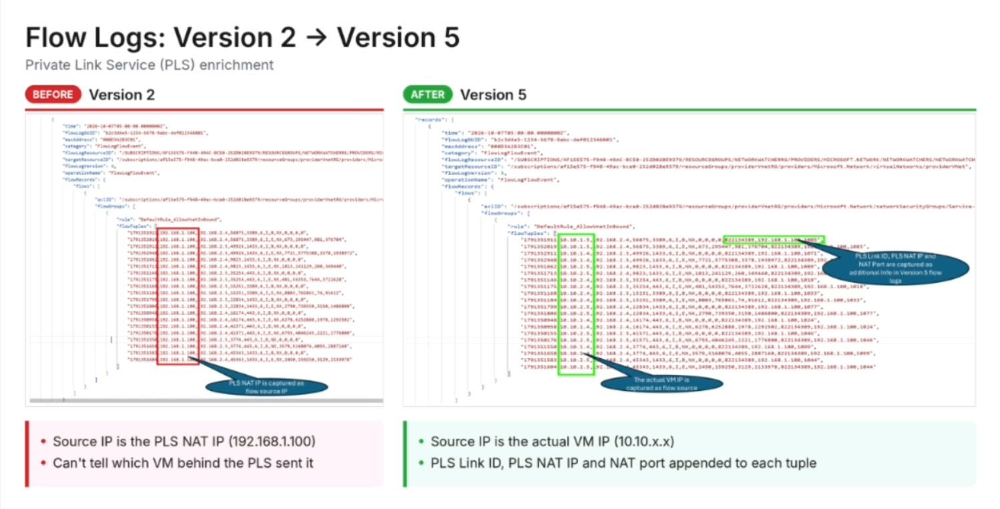
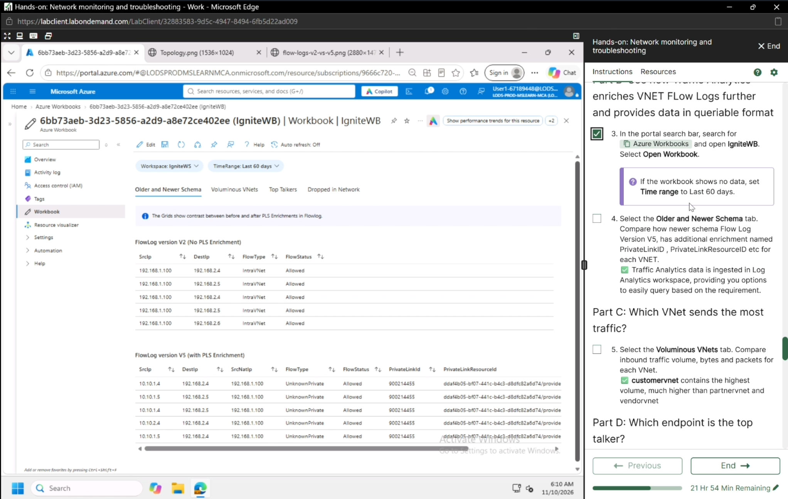
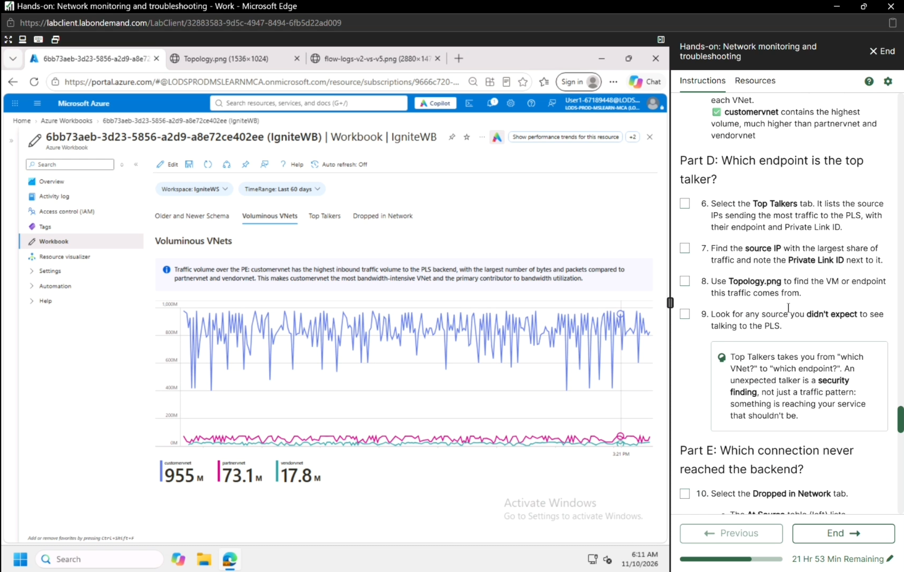
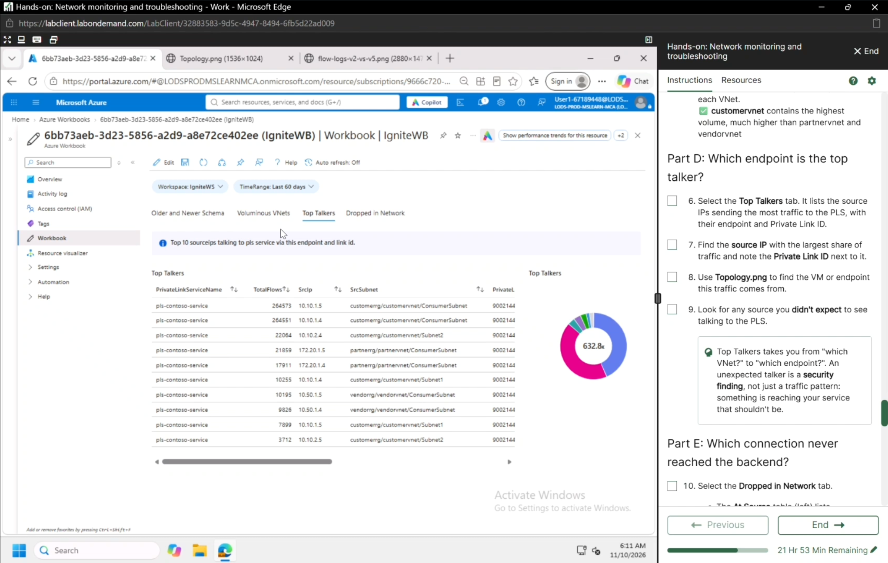
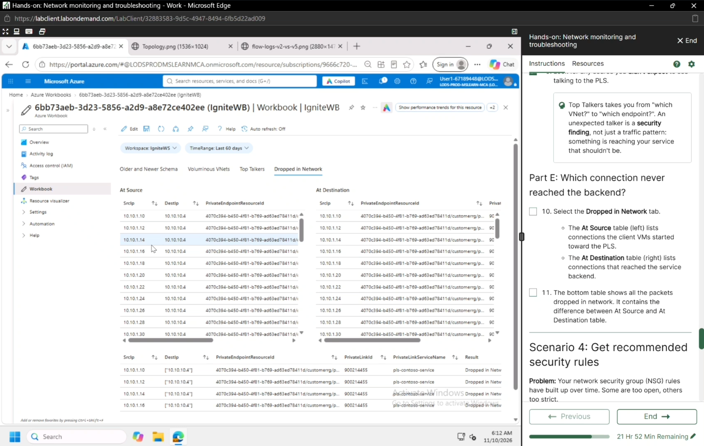

# 03 - Intro to Flow Logs and PLS Support

⬅️ [02 - Monitor and Troubleshoot Connectivity Issues](./02-Monitor-and-Troubleshoot-Connectivity-Issues.md) | **Next:** [04 - Traffic Analytics for Rule Recommendations](./04-Traffic-Analytics-for-Rule-Recommendations.md) ➡️

---

**Part 2: Traffic monitoring**

So far, you've checked whether connections work. Next, you'll look at **who is sending traffic, how much and where it goes**, using VNet flow logs and Traffic Analytics.

> [!NOTE]
> **Key concept:** **VNet flow logs** capture information about IP traffic flowing through a virtual network. To learn more, see the [VNet flow logs documentation](https://learn.microsoft.com/en-us/azure/network-watcher/vnet-flow-logs-overview).

---

## Scenario: Find what's overloading a Private Link Service

| | |
|---|---|
| **Problem** | You run a Private Link Service (PLS) that several VNets connect to through private endpoints. The service is slowing down, and one customer says some requests never arrive. |
| **Goal** | Find the VNet sending the most traffic, the endpoint behind it and any connection that never reached the backend. |
| **Tools** | VNet flow logs, Traffic Analytics, Azure Workbooks |
| **Time** | 10 minutes |

> [!NOTE]
> The data for this scenario is already loaded into the lab, so you don't need to wait for it.

---

## Part A: See what the updated flow logs capture for Private Link traffic

1. Look at the topology below. It shows the customer VNets connecting through private endpoints to the provider VNet that hosts the PLS. Keep it handy; you'll use it later.

   

   > In the lab environment, this image is also on the desktop as `Topology.png`.

2. Compare flow log Version 2 with Version 5.

   

   > In the lab environment, this image is also on the desktop as `flow-logs-v2-vs-v5.png`.

   ✅ **Check:** Each Version 5 record includes the actual **VM IP**, **PLS Link ID**, **PLS NAT IP** and **NAT port**. These fields weren't available in Version 2, where every source IP showed only the PLS NAT IP.

> [!NOTE]
> **Key concept:** The **PLS NAT IP** is the address the Private Link Service uses for traffic from consumers, which used to hide the real source. The **Private Link ID** tells you which private endpoint connection the traffic came through.

---

## Part B: See how Traffic Analytics enriches VNet flow logs

3. In the Azure portal search bar, search for **Azure Workbooks** and open **IgniteWB**. Select **Open Workbook**.

> [!TIP]
> **Troubleshooting:** If the workbook shows no data, set **Time range** to **Last 60 days**.

4. Select the **Older and Newer Schema** tab. Compare how the newer schema (flow log Version 5) adds enrichment such as **PrivateLinkID** and **PrivateLinkResourceID** for each VNet.

   ✅ **Check:** Traffic Analytics data is stored in a Log Analytics workspace, so you can easily query it for what you need.

   

---

## Part C: Which VNet sends the most traffic?

5. Select the **Voluminous VNets** tab. Compare the inbound traffic volume, bytes and packets for each VNet.

   ✅ **Check:** **customervnet** has the highest volume, much higher than **partnervnet** and **vendorvnet**.

   

---

## Part D: Which endpoint is the top talker?

6. Select the **Top Talkers** tab. It lists the source IPs sending the most traffic to the PLS, with their endpoint and Private Link ID.

   

7. Find the **source IP** with the largest share of traffic and note the **Private Link ID** next to it.

8. Use the topology image to find the VM or endpoint this traffic comes from.

> [!NOTE]
> **Key concept:** Top Talkers takes you from "which VNet?" to "which endpoint?". An unexpected talker is a **security finding**, not just a traffic pattern: something is reaching your service that shouldn't be.

---

## Part E: Which connection never reached the backend?

9. Select the **Dropped in Network** tab.

    - The **At Source** table (left) lists connections the client VMs started toward the PLS.
    - The **At Destination** table (right) lists connections that reached the service backend.

10. Review the bottom table. It shows all the packets dropped in the network: the difference between the **At Source** and **At Destination** tables.

    ✅ **Check:** You can see which connections left the client but never reached the backend.

    

---

## What you learned

| Tool | What you did |
|---|---|
| VNet flow logs | Saw the real source VM IP and Private Link details behind PLS traffic |
| Traffic Analytics, Azure Workbooks | Found the VNet sending the most traffic, the top-talking endpoint and connections dropped in the network |

---

⬅️ [02 - Monitor and Troubleshoot Connectivity Issues](./02-Monitor-and-Troubleshoot-Connectivity-Issues.md) | **Next:** [04 - Traffic Analytics for Rule Recommendations](./04-Traffic-Analytics-for-Rule-Recommendations.md) ➡️
