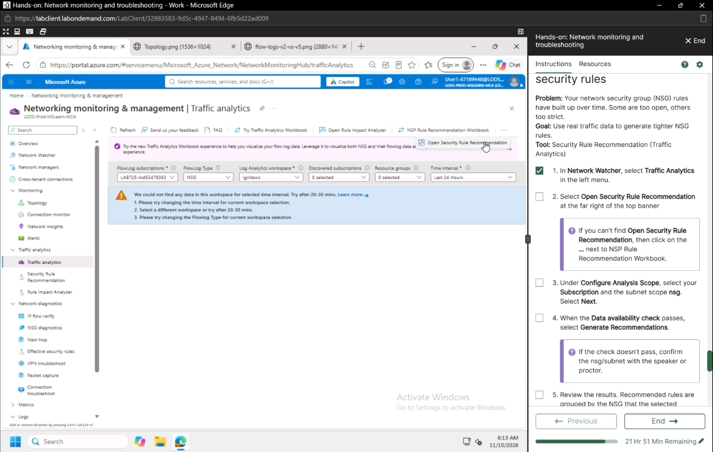
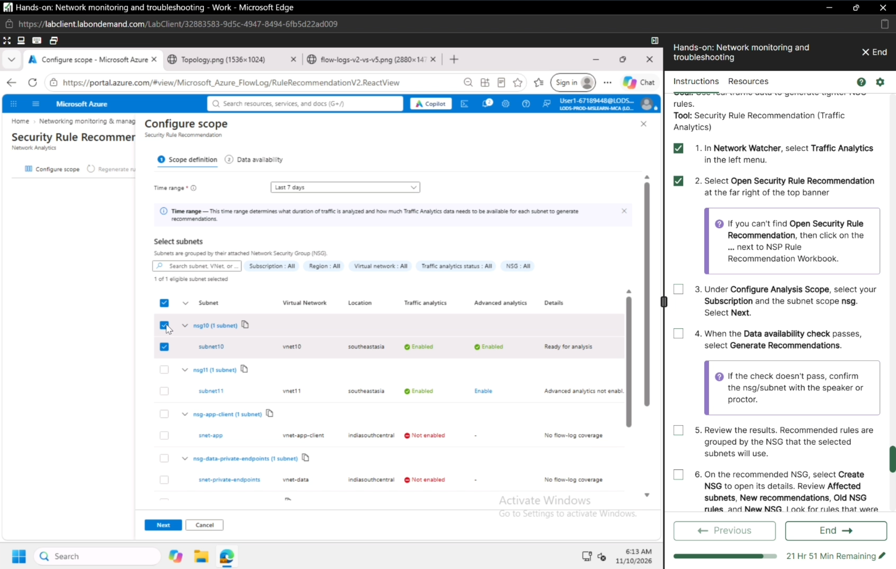
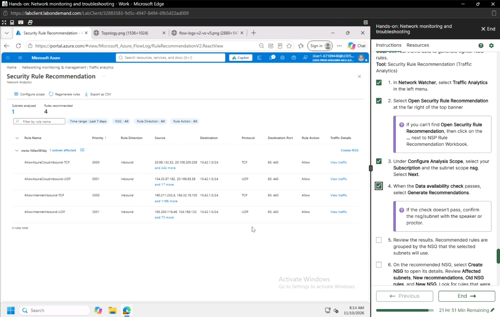
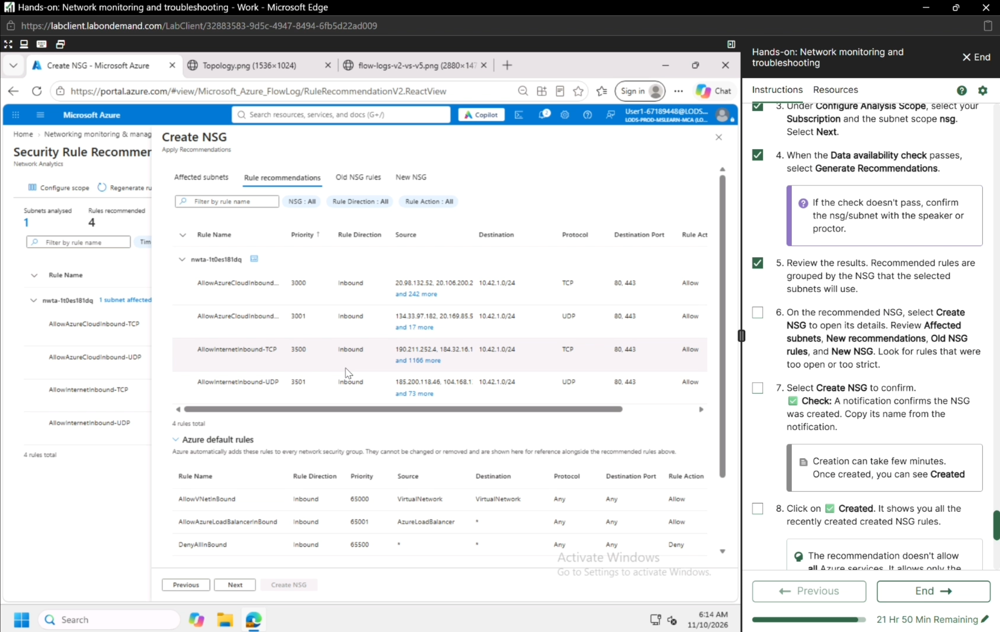

# 04 - Traffic Analytics for Rule Recommendations

⬅️ [03 - Intro to Flow Logs and PLS Support](./03-Intro-to-Flow-Logs-and-PLS-Support.md) | [Back to README](./README.md)

---

**Part 2: Traffic monitoring**

| | |
|---|---|
| **Problem** | Your network security group (NSG) rules have built up over time. Some are too open, others too strict. |
| **Goal** | Use real traffic data to generate tighter NSG rules. |
| **Tool** | Security Rule Recommendation (Traffic Analytics) |
| **Time** | 5-10 minutes |

---

## 🎬 Demo video

<!-- TODO: Replace the link below with the demo video URL -->
[Watch the Module 04 demo](VIDEO_LINK_04_RULE_RECOMMENDATIONS)

---

## Generate recommended security rules

1. In **Network Watcher**, select **Traffic Analytics** in the left menu.

2. Select **Open Security Rule Recommendation** at the far right of the top banner.

   

> [!TIP]
> **Troubleshooting:** If you can't find **Open Security Rule Recommendation**, select the **...** next to **NSP Rule Recommendation Workbook**.

3. Under **Configure Analysis Scope**, select your **Subscription** and the subnet scope **nsg10**. Select **Next**.

   

4. When the **Data availability check** passes, select **Generate Recommendations**.

5. Review the results. Recommended rules are grouped by the NSG that the selected subnets will use.

   

6. On the recommended NSG, select **Create NSG** to open its details. Review **Affected subnets**, **New recommendations**, **Old NSG rules** and **New NSG**. Look for rules that were too open or too strict.

   

7. Select **Create NSG** to confirm.

   ✅ **Check:** A notification confirms the NSG was created.

> [!NOTE]
> Creation can take a few minutes. When it's done, you'll see **Created**.

8. Select **✅ Created**. It shows all the NSG rules you created recently.

> [!NOTE]
> **Key concept:** The recommendation doesn't allow **all** Azure services. It allows only the specific Azure services your traffic actually uses, which follows the principle of least privilege.

---

## What you learned

| Tool | What you did |
|---|---|
| Security Rule Recommendation (Traffic Analytics) | Generated least-privilege NSG rules from real traffic and created a new NSG |

---

## 🎉 You're done!

---

⬅️ [03 - Intro to Flow Logs and PLS Support](./03-Intro-to-Flow-Logs-and-PLS-Support.md) | [Back to README](./README.md)
